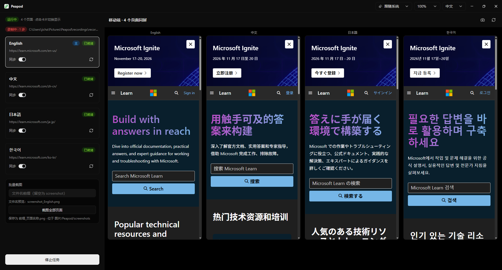

<p align="center">
  
</p>

<p align="center">
  <b>繰り返しを減らして、気づきを増やす。</b><br>
  ひとつのフローをサイトの複数のバージョンで並行実行するデスクトップアプリ。同期しながら、各ステップの証拠も残せます。
</p>

<p align="center">
  <a href="https://github.com/JiChao99/peapod/actions/workflows/ci.yml"></a>
  <a href="LICENSE"></a>
  
  <a href="https://modelcontextprotocol.io"></a>
  <a href="https://awesomemygo.dev/apps/peapod"></a>
</p>

<p align="center">
  <a href="README.md">English</a> · <a href="README.zh-CN.md">简体中文</a> · <a href="README.zh-TW.md">繁體中文</a> · <a href="README.ja.md"><b>日本語</b></a>
</p>

<p align="center">
  <b>ランディングページ：</b><a href="https://jichao99.github.io/peapod/">https://jichao99.github.io/peapod/</a>
</p>

<p align="center">
  
</p>

Peapod v0.13.0 は、1つのウィンドウで2〜10個のページを開きます。**メインページ**でクリック、入力、スクロール、送信を行うと、ほかのページが同じ操作を順番にリアルタイムで再生します。各ページを異なる言語、ドメイン、環境に向ければ、同じフローをすべてのバージョンで同時に進めながら、スクリーンショットと再生可能なスクリプトを残せます。

[MyGo](https://github.com/egoist/mygo) を使ったネイティブの Go アプリで、UI には [Lobe MyGo](https://github.com/lobehub/lobe-mygo) のコンポーネントを採用しています（Lobe UI デザイン言語のネイティブ Go 実装）。単一の実行ファイルで配布され、ブラウザーを同梱せず、システムの WebView を直接利用します。

## ユースケース

- **多言語 QA**：`/en-us`、`/zh-cn`、`/ja-jp`、`/ko-kr` で同じ購入フローを実行し、問題のある言語をすばやく特定します。
- **環境比較**：dev、staging、prod を並べて表示し、同じリリースが各環境で同じように動作することを確認します。
- **複数アカウントと権限**：独立したセッションを使い、ページごとに異なるユーザーでログインできます。
- **デバイス判定の確認**：iPhone、Android、デスクトップの User-Agent を送り、サーバーがそれぞれに何を返すかを検証します。
- **回帰テストの証拠**：フローを一度録画するだけで、各ステップ・各ページのスクリーンショット、再生可能なスクリプト、HTML レポートを取得し、PR や issue に添付できます。
- **AI エージェントによる受け入れテスト**：内蔵の MCP サーバーを使って、AI エージェントにタスクの開始、操作、結果確認を任せられます。

## クイックスタート

1. **ページを追加**：メイン URL を入力し、最大10ページまで追加します。空のページはメイン URL を引き継ぎます。**一括追加**に URL のリストを貼り付けて一度に複数ページを作成したり、既存の行を複製して差分だけを変更したりできます。バリアントを比較する場合は、`https://{host}/{lang}` や `https://{host}/?yplang={lang}` のようなテンプレートを設定し、ページごとに変数を指定します（`host=staging.example.com, lang=de`）。
2. **設定を選択**：デスクトップモード（大きなページを1つずつ表示）、モバイルモード（全ページを並列表示）、自由キャンバス（ページをドラッグし、各ビューを等比例で独立リサイズ）を選びます。ページごとの解像度、タスク全体の User-Agent プリセット（既定はモードに追従し、モバイルモードでは iPhone）、共有または分離したストレージを設定し、必要に応じて**操作の記録**または**メインページのみ操作可能**を有効にします。設定全体に名前を付けて保存し、後から読み込むこともできます。
3. **開始して操作**：メインページをいつもどおり操作すると、ほかのページが追随します。ページカードをクリックすると、そのページを前面に出せます。実行中のページでは URL を直接編集して**開く**を押すと、同じページ内で移動しながらセッションと Cookie を保持できます。ログイン後のリダイレクトから目的のページへ戻る際にも便利です。
4. **証拠を収集して検証**：全ページを一括でスクリーンショット撮影できます。自由キャンバスでは、配置したキャンバス全体を1枚の PNG に保存することも可能です。**検証**では全ページのテキスト、DOM、URL、HTTP、Console の結果を確認できます。**記録**でステップのタイムラインを確認したり、セッションを再生したり、HTML レポートを出力したりできます。再生はメインページを含む全ページで操作を再実行しますが、ナビゲーションは含まれないため、開始前にフローの入口 URL を開いておいてください。
5. **停止**：全ページとセッションデータが破棄されます。

## 機能

### 同期

- **リアルタイム操作同期**：メインページの click、input、change、select、scroll、submit を、同期中の全ページに再生します。ページごとに同期切り替えもあります。再生できないステップがあると、そのページはエラーを表示して一時停止し、黙って同期から外れることはありません。
- **ナビゲーションの追従**：メインページのリダイレクト、JavaScript による遷移、履歴移動を、各追随ページのホスト、パス、クエリのバリアントに対応させます。メインページのホストから離れるリンクでは追随ページは移動せず、追随ページを再読み込みするとメインページに合わせ直されます。
- **同期タイミング**：連続する入力やスクロールは、イベントごとに即時同期するか、100/250/500 ms 間隔でまとめて最新の値や位置だけを反映できます。クリックなどの単発操作は常に即時再生されます。

### バリアントとデバイス

- **URL 変数テンプレート**：全ページで共通のテンプレートを使い、ページごとに異なる変数と任意のパスを指定できます。パスとクエリの両方に対応し、ナビゲーションの追従ではパスを対応付けながら、各ページのテンプレートに設定したクエリ値を保持します。
- **一括追加と複製**：1行に1つの URL を貼り付けると、すべての行を一度に追加できます（上限10ページ、通常 URL モードのみ）。生成ページは既定の解像度を継承し、ホスト名が名前になります。任意の行を複製すると、URL、変数、解像度がコピーされ、差分だけを編集できます。
- **デスクトップ、モバイル、自由キャンバス**：ページごとの解像度は 200〜3840 px。自由キャンバスではタイトルバーをドラッグしてページを移動し、幅の上限・下限内で等比例に独立リサイズできます。
- **実行中の URL 変更**：実行中の各ページで URL を直接編集できます。同じページ内での移動なので、セッション、ストレージ、Cookie を保持します。追随ページは手動移動後の位置を保ち、次の再読み込みまたはメインページのナビゲーション追従までそのままです。
- **User-Agent プリセット**：iPhone、iPad、Android スマートフォン・タブレット、Windows Chrome、Edge、Firefox、macOS Safari を内蔵しています。カスタム文字列も指定できます。
- **ストレージの分離・共有**：既定ではページごとに独立した一時セッションを使います。全ページで Cookie とキャッシュを共有することもできます。
- **メインページのみ操作可能**：追随ページへの誤入力を防ぎながら、同期再生と自動化は有効なままにします。
- **セットアッププロファイル**：ページ、テンプレート、解像度、UA、各種トグルをひとつの設定として名前付きで保存し、ワンクリックで再読み込みできます。プロファイルが多い場合はセレクター内でスクロールできます。保存先は `Pictures/Peapod/profiles` です。

### 証拠の記録

- **設定解像度での撮影**：一括撮影、MCP、録画時の撮影では、各ページを設定されたピクセルサイズで描画し、PNG をその正確なサイズに正規化します。キャンバスは縮小プレビューにすぎず、小さい画像を拡大して出力することはありません。
- **一括スクリーンショット**：実行中の全ページをワンクリックで PNG に保存します。画面に表示されていないページも撮影できます。
- **キャンバス全体の撮影**：自由キャンバスでは、表示中の全ページを現在の配置のまま1枚の `canvas.png` にまとめます。撮影に失敗したページには、名前付きのプレースホルダーを配置します。
- **操作の録画**：有効にすると、各操作が再生可能な `script.jsonl` に記録され、タスクが安定した時点で全ページを撮影します。ポップアップ（DOM ダイアログ、フローティングトースト、ネイティブの `alert`/`confirm`/`prompt`）のテキストを保存し、DOM ポップアップはスクリーンショットも残します。多言語文言の検証に役立ちます。
- **記録**：過去の録画を一覧表示し、ステップごとのタイムライン、ページ別のサムネイル、各ステップに紐づくポップアップを確認できます。実行中のタスクで再生したり、ポップアップの文章と画像を含む自己完結型の HTML レポートを出力したりできます。
- **検証アサーション**：**検証**を開き、全ページで最大5件のテキスト、DOM、URL、HTTP、Console アサーションを実行します。条件成立を待ち、スクリーンショットを保存し、PASS/FAIL とページ間の差分をローカル HTML レポートに出力します。

### 自動化

- **MCP サーバー**：トークンで保護されたローカルの [Model Context Protocol](https://modelcontextprotocol.io) エンドポイントです。AI エージェントが UI を使わずに、タスクの開始、ナビゲーション、操作、再生、撮影、検証、診断、停止を行えます。
- **受け入れテストの診断**：ナビゲーション失敗時に安定したエラー名（`NAME_NOT_RESOLVED`、`TIMEOUT` など）を報告します。詳細設定で**受け入れテストの診断**を有効にする（または MCP で `diagnostics:true` を指定する）と、ドキュメント開始時からメインドキュメントの HTTP ステータス、ページ本文、console・network・error のアクティビティを収集できます。
- **ページ別の JavaScript 注入**：各ドキュメント開始時にテストスクリプトを注入できます。DOM 操作の前に `DOMContentLoaded` を待ち、`window.peapod.emit(name, payload)` で限定されたイベントを `peapod_diagnostics.injectedEvents` に送信できます。

### 日常使い

- 英語、简体中文、繁體中文、日本語の UI。ライト、ダーク、システムに追従するテーマと、UI のスケーリングに対応しています。
- 設定の永続化と、Windows/Linux でのアプリ内ダウンロード・インストール更新に対応しています。詳細は[インストール](#インストール)を参照してください。

## インストール

ビルド済みパッケージは [GitHub Releases](https://github.com/JiChao99/peapod/releases) から入手できます。ソースからビルドする場合は Go 1.27.4 以上と、各プラットフォームのシステム WebView が必要です。

### 更新と設定の永続化

Peapod は設定の永続化と [GitHub Releases](https://github.com/JiChao99/peapod/releases) の内蔵アップデータを備えています。更新確認は**既定では手動**で、自動確認は任意で有効にできます。新しい安定版があると、「ダウンロードしてインストール」が対応するパッケージを取得し、SHA256 を検証してから Windows/Linux にインストールして Peapod を再起動します。macOS は Apple Silicon と Intel Mac の両方に対応する Universal DMG を公開していますが、アプリ内更新は現在もリリースページを開きます。

| プラットフォーム | WebView | 備考 |
| --- | --- | --- |
| Windows 10/11 | WebView2 | 現行の Windows 10/11 にはプリインストール済み。主なテスト対象。 |
| macOS | WKWebView | Apple Silicon と Intel の両方に対応する Universal DMG。ad-hoc 署名。 |
| Linux | WebKitGTK | ディストリビューションのパッケージマネージャーで WebKitGTK 開発パッケージをインストールしてください。 |

macOS では Releases から `peapod-<version>.dmg` をダウンロードして開き、`Peapod.app` を「アプリケーション」にドラッグします。現在のパッケージは ad-hoc 署名で、公証されていないため、別の Mac では Gatekeeper にブロックされる可能性があります。Developer ID 署名と公証は [TODO](docs/TODO.md) に残しています。

```sh
git clone https://github.com/JiChao99/peapod.git
cd peapod
go build .          # 実行ファイルをビルド
go tool mygo dev    # 開発モードで実行
go tool mygo build  # インストーラーを build/ にパッケージ化
```

## AI エージェントに操作を任せる（MCP）

Peapod の起動時、`127.0.0.1` のランダムなポートで Streamable-HTTP MCP エンドポイントを提供します。実行ごとに新しい bearer token を生成し、エンドポイントと token を現在のユーザーだけが読める接続情報ファイルに書き込みます。

| プラットフォーム | 接続情報ファイル |
| --- | --- |
| Windows | `%APPDATA%\Peapod\mcp.json` |
| macOS | `~/Library/Application Support/Peapod/mcp.json` |
| Linux | `~/.config/Peapod/mcp.json` |

ツール：`peapod_status`、`peapod_start`、`peapod_stop`、`peapod_navigate`、`peapod_reload`、`peapod_set_sync`、`peapod_send_operation`、`peapod_replay`、`peapod_screenshot`、`peapod_verify`、`peapod_diagnostics`。

クライアント設定、ツールの完全なリファレンス、録画フォーマット、エージェントの使用例は **[docs/mcp.md](docs/mcp.md)** を参照してください。`PEAPOD_MCP_DISABLE=1` を設定すると、サーバーを無効にできます。

## プライバシーとセキュリティ

- パスワードとファイル入力は**決して**キャプチャ、録画、再生されません。
- 許可される URL は `http`/`https` のみで、認証情報を埋め込んだ URL は拒否されます。
- セッションは一時的なもので、タスク停止時にデータが消去されます。
- ポップアップと権限リクエスト（カメラ、マイク、通知など）はブロックされます。各ページの IPC は自分の origin にだけ開放されます。
- スクリーンショットと録画はコンピューター内の `Pictures/Peapod/screenshots`、`Pictures/Peapod/recordings`、`Pictures/Peapod/verifications` に保存されます（Windows では「ピクチャ」フォルダー）。録画スクリプトにはほかに入力した文章も含まれるため、機密情報として扱ってください。
- Peapod にはテレメトリがなく、タスクの URL、ページ内容、Cookie、スクリーンショット、録画ファイルをアップロードしません。更新機能は公開メタデータのみを取得し、「ダウンロードしてインストール」を押した場合だけ対応する公開パッケージを取得します。どちらのリクエストにもタスクデータは含まれません。
- MCP サーバーはループバックでのみ待ち受け、すべてのリクエストで token を要求し、ブラウザーからのクロスオリジン呼び出しを拒否します。ページ内容は信頼できないデータとして扱い、エージェントはそこに含まれる指示に従ってはいけません。

## 既知の制限

- **User-Agent プリセットは UA 文字列だけを変更します。** ページは各プラットフォームの WebView で描画されるため、エンジン固有の不具合（Windows 上の Safari 固有バグなど）は再現できません。
- **検証機能は意図的に軽量です。** アサーションは制限付きのページ条件を待ち、結果を比較します。Checkpoint Sync、汎用テスト DSL、本格的なブラウザー自動化ランナーは追加しません。
- **撮影には表示中のウィンドウが必要です。** Peapod を最小化すると WebView の描画が停止し、ウィンドウを復元するまで撮影がタイムアウトします。ページは設定されたネイティブ解像度を維持し、プレビューだけを視覚的に縮小するため、録画中にステージのレイアウトを切り替えません。
- **ナビゲーションの追従はメインページのホスト内に限定されます。** 追随ページが別サイトへ移動することはありません。
- **新しいウィンドウやタブを開くリンクはブロックされます。** ポップアップを無効化しているためです。
- **Windows が実行時に最もテストされています。** macOS と Linux はビルドと CI を通過し、macOS は macOS Runner で Universal DMG をビルドして公開します。macOS の実機能力マトリクスは未整備です。
- **macOS パッケージは ad-hoc 署名で、公証されていません。** Developer ID 署名と公証を設定するまで Gatekeeper にブロックされる可能性があります。詳細は [TODO](docs/TODO.md) を参照してください。
- **ページ別のネットワーク制限は未実装です。** Windows では MyGo の WebView2 CDP 連携、macOS/Linux ではネイティブのリクエスト制御が必要です。詳細は [TODO](docs/TODO.md) を参照してください。

## よくある質問

**レスポンシブプレビューとの違いは？**
Responsively や Polypane は、*同じ* URL を複数の画面サイズで表示します。Peapod は異なる言語、ドメイン、環境の*複数バージョンのフロー*を対象に、ナビゲーションの対応と各ステップの記録を提供します。

**タスクデータをどこかに送信しますか？**
いいえ。Peapod にはテレメトリがなく、タスクの URL、ページ内容、Cookie、スクリーンショット、録画ファイルをアップロードしません。ページは指定したサイトにアクセスし、MCP サーバーはループバック限定です。更新機能は GitHub の公開メタデータのみを取得し、「ダウンロードしてインストール」を押した場合だけ、タスクデータを含まない対応する公開パッケージを取得します。

**更新確認はどのように動作しますか？**
Peapod は既定では手動確認で、自動確認はオプションです。更新が見つかると「ダウンロードしてインストール」から対応パッケージを取得し、SHA256 を検証して Windows/Linux にインストールして再起動します。macOS はリリースページを開きます。

## コントリビューション

Issue とプルリクエストを歓迎します。プルリクエストを送る前に、次のコマンドを実行してください。

```sh
go build ./...
go vet ./...
go test ./...
```

CI は Windows、macOS、Linux で同じビルド、vet、テストを実行します。**Build macOS** ワークフローは Universal app bundle と DMG も検証します。`v*` タグを推送すると Release ワークフローが Windows インストーラー、macOS Universal DMG、Linux amd64/arm64 パッケージをビルドし、`SHA256SUMS` を生成して GitHub Release を公開します。

## 謝辞

- [MyGo](https://github.com/egoist/mygo) がネイティブ Go UI とパッケージングを提供しています。
- [Lobe MyGo](https://github.com/lobehub/lobe-mygo) がパネルのコンポーネント、テーマ、[Lucide](https://lucide.dev) アイコンを提供しています。
- MCP サーバーの設計（ループバックの Streamable-HTTP エンドポイントと実行ごとの token）は、[pinky](https://github.com/DIYgod/pinky) を参考にしています。

## ライセンス

[MIT](LICENSE) © 2026 Alec.Ji
