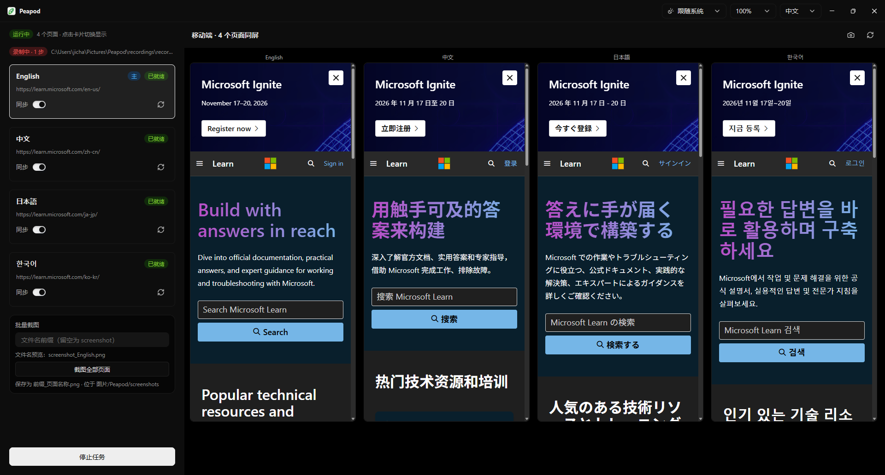

<p align="center">
  
</p>

<p align="center">
  <b>一次操作，頁頁跟隨。</b><br>
  一款桌面應用程式，可讓同一條流程同時執行於網站的多個版本：並排顯示、即時同步，並保留每一步證據。
</p>

<p align="center">
  <a href="https://github.com/JiChao99/peapod/actions/workflows/ci.yml"></a>
  <a href="LICENSE"></a>
  
  <a href="https://modelcontextprotocol.io"></a>
  <a href="https://awesomemygo.dev/apps/peapod"></a>
</p>

<p align="center">
  <a href="README.md">English</a> · <a href="README.zh-CN.md">简体中文</a> · <a href="README.zh-TW.md"><b>繁體中文</b></a> · <a href="README.ja.md">日本語</a>
</p>

<p align="center">
  <b>官方網站：</b><a href="https://jichao99.github.io/peapod/">https://jichao99.github.io/peapod/</a>
</p>

<p align="center">
  
</p>

Peapod v0.12.0 可於單一視窗開啟 2–10 個頁面。你在**主頁**上點擊、輸入、捲動及送出，其餘頁面會依序即時重播相同操作。把各頁面指向不同語言、網域或環境，就能讓同一條流程在所有版本上同步走一遍，並留下截圖與可回放的腳本。

這是一款以 [MyGo](https://github.com/egoist/mygo) 打造的原生 Go 應用程式，介面採用 [Lobe MyGo](https://github.com/lobehub/lobe-mygo) 元件（Lobe UI 設計語言的原生 Go 實作）。它以單一執行檔提供，直接使用系統 WebView，不內建瀏覽器。

## 使用情境

- **多語言 QA**：讓 `/en-us`、`/zh-cn`、`/ja-jp`、`/ko-kr` 走同一套結帳流程，迅速找出出問題的語言。
- **多環境比較**：並排顯示 dev、staging 與 prod，確認同一個發行在各環境中行為一致。
- **多帳號與角色流程**：各頁面使用獨立工作階段，可分別以不同使用者身分登入。
- **裝置判定驗證**：提供 iPhone、Android 或桌面 User-Agent，確認伺服器分別返回什麼內容。
- **迴歸測試留證**：錄製一次流程，取得每一步、每頁的截圖、可回放腳本與 HTML 報告，直接附在 PR 或問題單中。
- **交由 AI agent 驗收**：讓 AI agent 透過內建 MCP 伺服器啟動任務、執行操作並檢查結果。

## 快速開始

1. **新增頁面**：輸入主頁 URL，最多新增 10 個頁面；留空的頁面沿用主頁 URL。使用**批次新增**貼上 URL 清單，一次產生多頁，或複製任一列再修改差異。若要比較變體，可設定 `https://{host}/{lang}` 或 `https://{host}/?yplang={lang}` 這類範本，再為每頁填入自己的變數（`host=staging.example.com, lang=de`）。
2. **選擇設定**：選擇桌面模式（一次顯示一個大頁面）、行動模式（所有頁面並排），或自由畫布（可拖曳頁面，並等比例獨立調整大小）；設定每頁解析度，為整個任務選擇一個 User-Agent 預設（預設跟隨模式，因此行動模式使用 iPhone），選擇共用或隔離儲存空間，並視需要開啟**操作錄製**或**僅限主頁操作**。也可將整套設定儲存為具名設定檔，之後直接載入。
3. **啟動並操作**：像平常一樣操作主頁，其餘頁面會自動跟隨。點擊頁面卡片可將該頁移到最前面。執行中可直接修改任一頁面的 URL 並按下**開啟**，在同一頁面內跳轉並保留工作階段與 Cookie，適合登入後返回原本要訪問的頁面。
4. **收集證據並驗證**：一鍵批次截圖所有頁面，自由畫布另可將整張畫布儲存為一張 PNG；也可開啟**驗證**，檢查全部頁面的文字、DOM、URL、HTTP 與 Console 結果。開啟**錄製紀錄**可查看步驟時間軸、回放工作階段或匯出 HTML 報告。回放會在包含主頁在內的所有頁面重播操作，但不包含導覽，因此請先在流程入口 URL 啟動任務。
5. **停止任務**：所有頁面隨即關閉，工作階段資料全部清除。

## 功能

### 同步

- **即時操作同步**：主頁上的 click、input、change、select、scroll、submit 都會回放到所有同步中的頁面，每頁都有獨立的同步開關。某頁無法重播步驟時會暫停並顯示錯誤，不會悄悄失去同步。
- **導覽跟隨**：主頁發生重新導向、JS 跳轉或前進後退時，各跟隨頁會在自己的主機與路徑／查詢參數版本上開啟對應頁面，保留各自設定的語言。離開主頁主機的連結不會帶動跟隨頁；重新載入跟隨頁即可讓它重新與主頁對齊。
- **同步節奏**：連續輸入與捲動可逐事件即時同步，也可依 100/250/500 ms 間隔合併，只保留最新數值或位置；點擊等離散操作一律即時回放。

### 變體與裝置

- **URL 變數範本**：所有頁面共用一個範本，每頁填入自己的變數，路徑可選；支援路徑與查詢參數變體，導覽跟隨會對應路徑並保留各頁範本中的查詢參數。
- **批次新增與複製**：每行一個 URL，貼上清單即可一次附加全部頁面（最多 10 頁，僅普通 URL 模式）；產生的頁面繼承預設解析度，並以主機名自動命名。複製任一列可複製其 URL、變數與解析度，只需修改差異。
- **桌面、行動與自由畫布**：每頁解析度可在 200–3840 px 之間調整。自由畫布可拖曳標題列移動頁面，並在寬度上下限內等比例獨立縮放。
- **執行中修改 URL**：每個執行中的頁面都可直接編輯 URL。跳轉仍發生在同一頁面內，因此保留工作階段、儲存空間與 Cookie；跟隨頁會停在手動跳轉後的位置，直到下次重新載入或主頁下一次導覽跟隨。
- **User-Agent 預設**：內建 iPhone、iPad、Android 手機與平板、Windows Chrome、Edge、Firefox、macOS Safari，也可貼上自訂 UA。
- **隔離或共用儲存空間**：預設每頁使用獨立的工作階段，也可讓所有頁面共用 Cookie 與快取。
- **僅限主頁操作**：避免誤觸跟隨頁，但同步回放與自動化仍會正常運作。
- **設定檔**：將整套設定——頁面、範本、解析度、UA 與開關——以名稱儲存，之後一鍵載入。設定檔較多時，選單內部可捲動。設定檔存於 `Pictures/Peapod/profiles`。

### 證據留存

- **依設定解析度截圖**：批次、MCP 與錄製截圖都會先按每頁設定的像素尺寸渲染，再將 PNG 正規化為該精確尺寸。畫布只是縮放預覽，截圖不會放大小圖。
- **批次截圖**：一鍵將每個執行中的頁面儲存為 PNG，目前不在螢幕上的頁面也能截取。
- **整張畫布截圖**：自由畫布下可依目前排列將所有可見頁面合成一張 `canvas.png`；單一頁面失敗時，會在對應位置放入含名稱的佔位圖。
- **操作錄製**：開啟後，每項操作都會寫入可回放的 `script.jsonl`，任務穩定後還會截取所有頁面。彈出視窗（DOM 對話框、浮動提示、原生 `alert`/`confirm`/`prompt`）會記錄文字，DOM 彈出視窗另附截圖，方便驗證多語言文案。
- **錄製紀錄檢視器**：列出歷史錄製，可查看逐步時間軸、每頁縮圖與穿插在步驟中的彈出視窗；可在執行中的任務上回放，也可匯出包含彈出視窗文字與截圖的獨立 HTML 報告。
- **驗證斷言**：開啟**驗證**，對全部頁面執行最多 5 條文字、DOM、URL、HTTP 或 Console 斷言。Peapod 會等待條件成立、留存截圖，並在本機 HTML 報告中列出 PASS/FAIL 與跨頁面差異。

### 自動化

- **MCP 伺服器**：由 token 保護的本機 [Model Context Protocol](https://modelcontextprotocol.io) 端點，讓 AI agent 無需操作介面，即可啟動任務、導覽、執行操作、回放、截圖、驗證、診斷與停止任務。
- **驗收診斷**：導覽失敗時會提供固定的錯誤名稱（`NAME_NOT_RESOLVED`、`TIMEOUT` 等）。在進階設定中開啟**驗收診斷**（或透過 MCP 傳入 `diagnostics:true`），即可從文件開始時收集主文件 HTTP 狀態、頁面文字，以及 console、network 與 error 活動。
- **每檢視 JS 注入**：可在每個文件開始時注入測試指令碼。存取 DOM 前請等待 `DOMContentLoaded`；呼叫 `window.peapod.emit(name, payload)` 可把受限事件回傳至 `peapod_diagnostics.injectedEvents`。

### 日常體驗

- 英語、簡體中文、繁體中文與日語介面；淺色、深色或跟隨系統主題，並支援介面縮放。
- 現已提供設定持久化，並支援 Windows/Linux 應用程式內下載安裝更新，詳見[安裝](#安裝)。

## 安裝

預編譯套件可於 [GitHub Releases](https://github.com/JiChao99/peapod/releases) 取得，也可從原始碼建置。建置需要 Go 1.27.4 或更新版本，以及各平台的系統 WebView：

### 更新與設定持久化

Peapod 內建設定持久化與 [GitHub Releases](https://github.com/JiChao99/peapod/releases) 更新器。更新檢查**預設為手動**，也可選擇自動檢查。發現新穩定版後，點擊「下載並安裝」會取得相符的發行包、校驗 SHA256，然後在 Windows/Linux 上安裝並重新啟動 Peapod；macOS 因暫無安裝包，會開啟發行頁。

| 平台 | WebView | 說明 |
| --- | --- | --- |
| Windows 10/11 | WebView2 | 目前版本的 Windows 10/11 已預裝；主要測試平台。 |
| macOS | WKWebView | 系統內建。 |
| Linux | WebKitGTK | 請透過發行版套件管理器安裝 WebKitGTK 開發套件。 |

```sh
git clone https://github.com/JiChao99/peapod.git
cd peapod
go build .          # 建置執行檔
go tool mygo dev    # 或以開發模式執行
go tool mygo build  # 或將安裝套件打包至 build/
```

## 讓 AI agent 接手操作（MCP）

Peapod 啟動後，會在 `127.0.0.1` 的隨機連接埠提供 Streamable-HTTP MCP 端點。每次執行都會產生新的 bearer token，端點與 token 會一起寫入只有目前使用者可讀取的連線資訊檔：

| 平台 | 連線資訊檔 |
| --- | --- |
| Windows | `%APPDATA%\Peapod\mcp.json` |
| macOS | `~/Library/Application Support/Peapod/mcp.json` |
| Linux | `~/.config/Peapod/mcp.json` |

工具：`peapod_status`、`peapod_start`、`peapod_stop`、`peapod_navigate`、`peapod_reload`、`peapod_set_sync`、`peapod_send_operation`、`peapod_replay`、`peapod_screenshot`、`peapod_verify`、`peapod_diagnostics`。

用戶端設定、完整工具說明、錄製格式與 agent 使用範例見 **[docs/mcp.md](docs/mcp.md)**。設定 `PEAPOD_MCP_DISABLE=1` 可關閉此服務。

## 隱私與安全

- 密碼與檔案輸入**絕不會**被擷取、錄製或回放。
- 只接受 `http`/`https` URL，內嵌認證資訊的 URL 會被拒絕。
- 工作階段都是暫時的，任務停止時資料即被清除。
- 彈出視窗與權限請求（攝影機、麥克風、通知等）會被封鎖；每頁的 IPC 只對自己的 origin 開放。
- 截圖與錄製只留在本機，分別位於 `Pictures/Peapod/screenshots`、`Pictures/Peapod/recordings` 與 `Pictures/Peapod/verifications`（Windows 上即「圖片」資料夾）。錄製腳本包含其他輸入文字，請視為敏感檔案。
- Peapod 沒有遙測，不會上傳任務 URL、頁面內容、Cookie、截圖或錄製檔案。更新功能只取得公開發行元資料；只有點擊「下載並安裝」後才會下載相符公開套件，兩種請求都不包含任務資料。
- MCP 伺服器只監聽本機迴環位址，每個請求都必須帶 token，並拒絕瀏覽器發出的跨源請求。頁面內容屬於不可信資料，agent 不應執行其中夾帶的指令。

## 已知限制

- **User-Agent 預設只改變 UA 字串**：頁面仍由平台 WebView 渲染，因此無法重現特定引擎的問題（例如在 Windows 上重現 Safari 獨有的 bug）。
- **驗證層保持輕量**：斷言只等待有界的頁面條件並比較結果，不引入 Checkpoint Sync、通用測試 DSL 或完整的瀏覽器自動化執行器。
- **截圖需要視窗可見且不可最小化**：Peapod 最小化時 WebView 會停止渲染，截圖會逾時，直到視窗恢復。頁面始終保持設定的原生解析度，僅對預覽做視覺縮放，因此錄製不再切換舞台配置。
- **導覽跟隨只在主頁所在主機內生效**：跟隨頁不會跟著跳到其他網站，這是刻意設計。
- **開啟新視窗或新分頁的連結會被封鎖**，因為彈出視窗已停用。
- **Windows 測試最充分**：macOS 與 Linux 均受支援；Linux 可建置並通過 CI，macOS 暫未納入 CI。
- **暫不支援每檢視弱網模擬**：Windows 需擴充 MyGo 的 WebView2 CDP 綁定，macOS/Linux 需原生請求控制，詳見 [TODO](docs/TODO.md)。

## 常見問題

**它與響應式預覽工具有什麼不同？**
Responsively、Polypane 這類工具是把*同一個* URL 以多種螢幕尺寸顯示。Peapod 面向同一條流程的*多個版本*（不同語言、網域或環境）同時執行：自動在它們之間對應導覽，並記錄每一步。

**它會把任務資料傳到別處嗎？**
不會。Peapod 沒有遙測，不會上傳任務 URL、頁面內容、Cookie、截圖或錄製檔案。頁面會聯絡你開啟的網站，MCP 伺服器也只允許本機存取。更新功能只向 GitHub 取得公開發行元資料；只有點擊「下載並安裝」後，才會下載不含任務資料的相符公開套件。

**更新檢查如何運作？**
Peapod 預設手動檢查，自動檢查需主動開啟。發現更新後點擊「下載並安裝」，會下載相符套件、校驗 SHA256，並在 Windows/Linux 上安裝重新啟動；macOS 暫開啟發行頁。

## 參與貢獻

歡迎提交 Issue 與 PR。發送 PR 前請先執行：

```sh
go build ./...
go vet ./...
go test ./...
```

CI 會在 Windows 與 Linux 上執行相同的建置、vet 與測試步驟。推送 `v*` tag 後，Release 工作流程還會建置 Windows 安裝套件與 Linux amd64/arm64 套件、產生 `SHA256SUMS` 並發布 GitHub Release。

## 致謝

- [MyGo](https://github.com/egoist/mygo) 提供原生 Go UI 與打包能力。
- [Lobe MyGo](https://github.com/lobehub/lobe-mygo) 提供面板元件、主題與 [Lucide](https://lucide.dev) 圖示。
- MCP 伺服器的設計（本機迴環 Streamable-HTTP 端點與每次執行產生的 token）參考了 [pinky](https://github.com/DIYgod/pinky)。

## 授權條款

[MIT](LICENSE) © 2026 Alec.Ji
